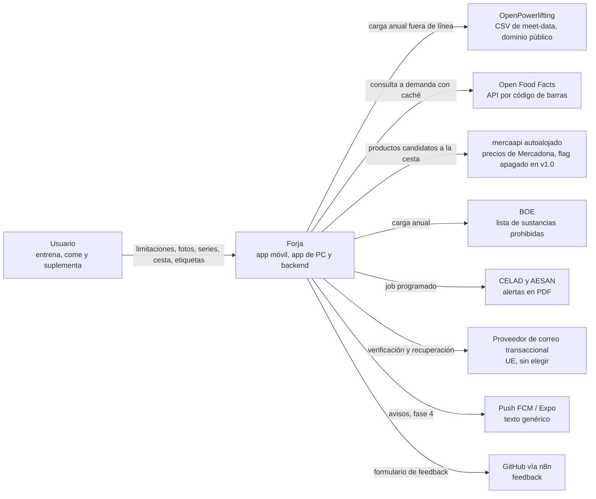
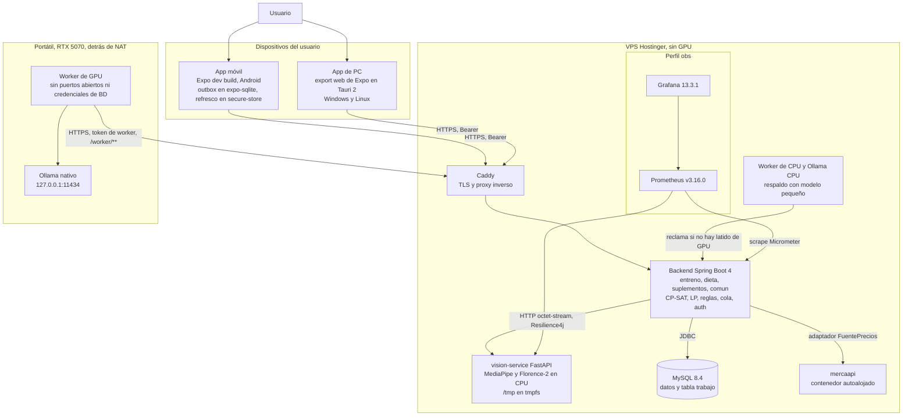
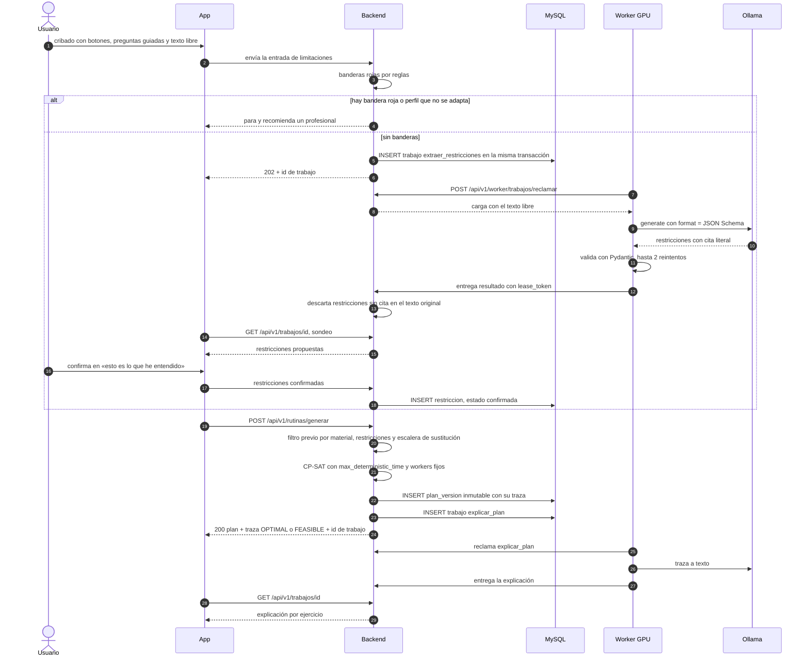
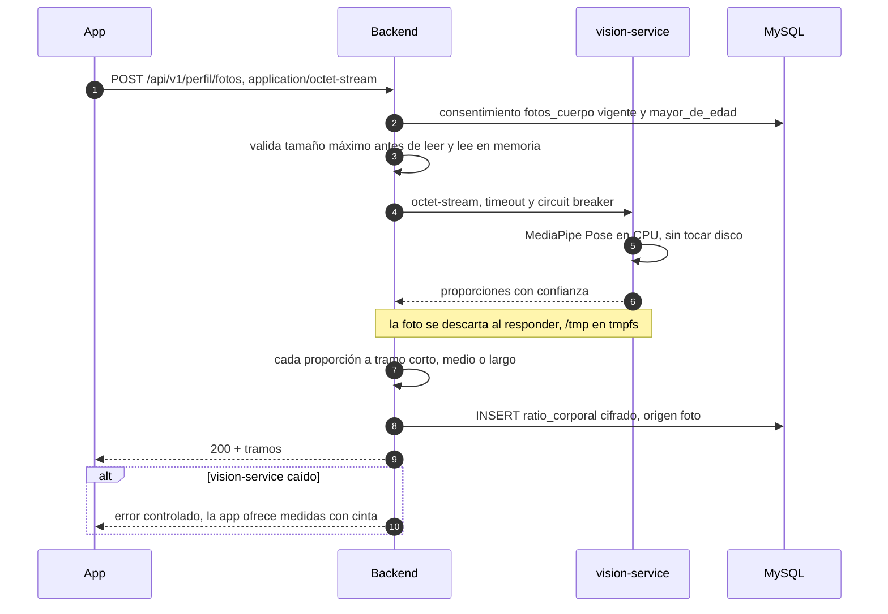
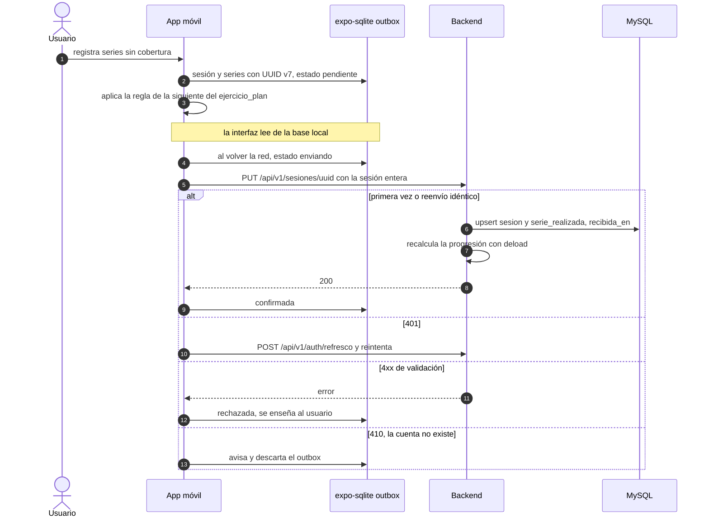
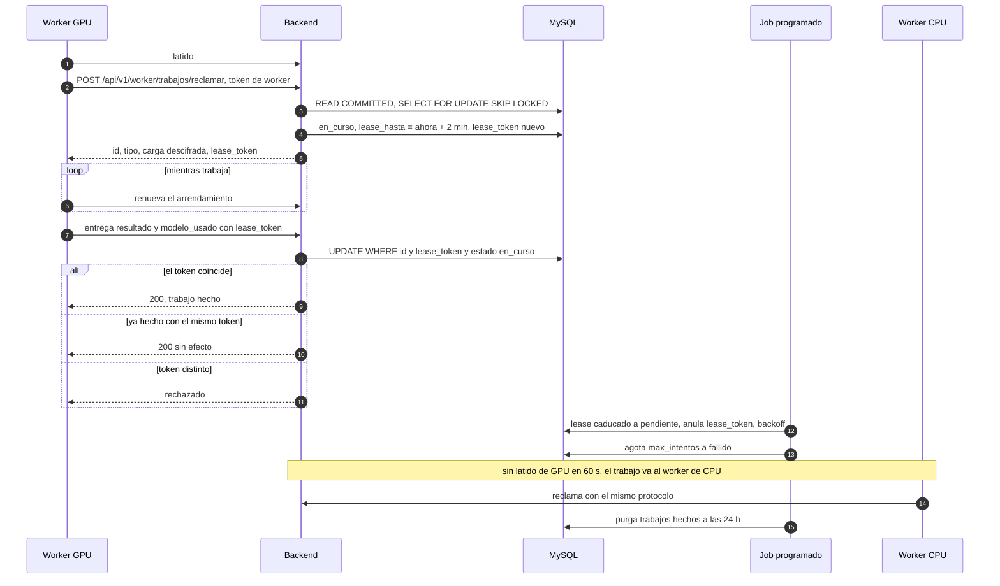
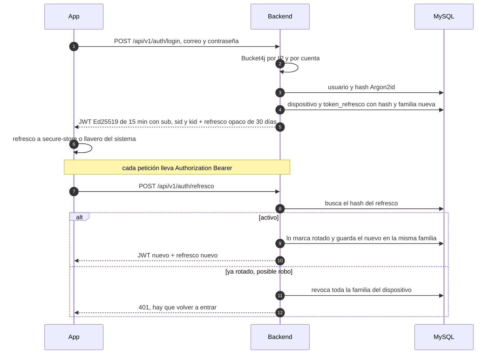
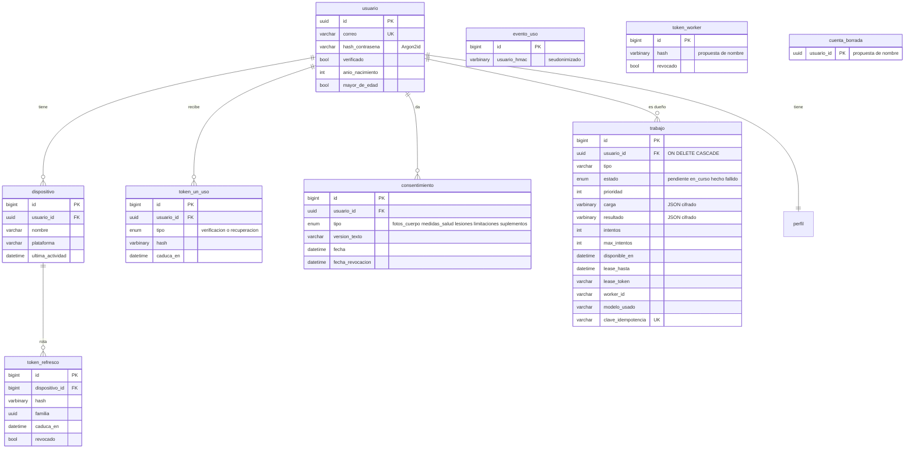
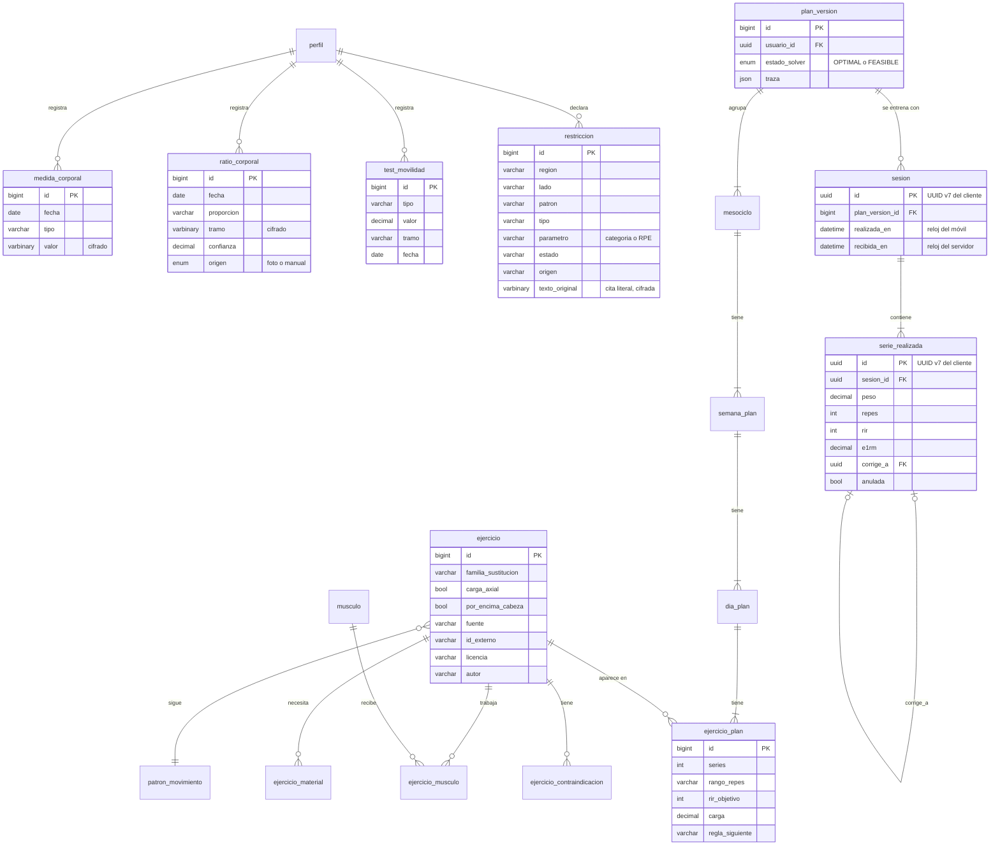
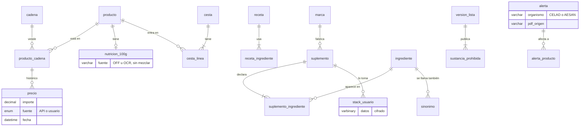

# Arquitectura de Forja

Estado a 2026-11-16, fase 0 cerrada: hay ADR, compose y CI, pero aún no hay código de aplicación. Los [ADR](adr/README.md) mandan sobre este documento, y la enmienda fechada de cada ADR manda sobre su texto original. Lo marcado **[propuesta]** no sale de ningún ADR: es un hueco que se cierra al implementar.

## 1. Resumen

- **Backend:** monolito modular en Java 21 + Spring Boot 4, organizado por dominios. Tiene las reglas, los solvers (CP-SAT y LP), la cola de trabajos y la autenticación.
- **`vision-service`:** FastAPI + Pydantic, sin estado. Hace la pose con MediaPipe y el OCR con Florence-2, los dos en CPU y en memoria, y la salida de LLM validada.
- **App:** Expo + React Native (TypeScript). Android con registro de series sin conexión, y PC con el export web dentro de Tauri 2.
- **Base de datos:** MySQL 8.4 LTS, fuente de verdad única. También hace de cola, con `SELECT … FOR UPDATE SKIP LOCKED`.
- **GPU:** un worker en el portátil (RTX 5070) tira de la cola por HTTPS y usa Ollama nativo. Si no hay latido, el trabajo lo hace un worker de CPU en el VPS.

## 2. Diagramas

### 2.1 Contexto (C4, nivel 1)

### 2.2 Contenedores (C4, nivel 2)

Dónde vive el worker de CPU (dentro del backend, del `vision-service` o en un proceso aparte) no lo fija ningún ADR **[propuesta: proceso aparte con el mismo cliente que el worker de GPU]**.

### 2.3 Secuencias

**(a) Limitaciones → restricciones confirmadas → CP-SAT → plan + traza → explicación** ([0002](adr/0002-solver-cp-sat.md), [0003](adr/0003-cola-de-trabajos-gpu.md), [0007](adr/0007-motor-de-seleccion-de-ejercicios.md))

**(b) Foto de cuerpo síncrona en memoria → tramos** ([0003](adr/0003-cola-de-trabajos-gpu.md) enmienda 1, [0004](adr/0004-privacidad-fotos-y-datos-de-salud.md), [0007](adr/0007-motor-de-seleccion-de-ejercicios.md))

Que la clasificación en tramos la haga el backend y no el `vision-service` es **[propuesta]**: los ADR dicen que el servicio de IA no tiene lógica de negocio.

**(c) Registro sin conexión con outbox** ([0008](adr/0008-sincronizacion-sin-conexion.md))

Una corrección es una serie nueva con `corrige_a`; una anulación es una serie con `anulada = true`. Nada se edita en el servidor.

**(d) Trabajo reclamado por el worker de GPU con arrendamiento** ([0003](adr/0003-cola-de-trabajos-gpu.md))

**(e) Login y refresco rotatorio** ([0009](adr/0009-autenticacion.md))

## 3. Componentes

### `backend/`
- **Stack:** Java 21 (Temurin en el CI), Spring Boot 4, JPA, Flyway (nunca `ddl-auto=update`), springdoc con OpenAPI exportado a [`docs/api/`](api/). Seguridad con Spring Security, Bucket4j, Bean Validation y `ProblemDetail` (RFC 9457). Resilience4j hacia el `vision-service`. Solvers con OR-Tools: CP-SAT para la rutina y GLOP, o CP-SAT con raciones enteras, para la dieta. Tests con JUnit 5, Mockito, tests de propiedades con semilla fija, Testcontainers con MySQL real y JaCoCo (≥ 80 % en el dominio).
- **Estructura:** un paquete por dominio, cada uno con `api`, `servicio`, `repositorio` y `modelo`. Un dominio no toca las tablas de otro.
  - `entreno/`: perfil, limitaciones y banderas rojas por reglas, tests de movilidad, CP-SAT con filtro previo, holgura, traza y alternativas, `plan_version`, sesiones idempotentes, progresión doble con su máquina de estados (`acumulando`, `subir_carga`, `estancado`, `deload`) y percentiles.
  - `dieta/`: Mifflin-St Jeor, LP de la cesta, `FuentePrecios`, `FuenteNutricion`, avisos de precio y recalcular las macros de las recetas.
  - `suplementos/`: motor de riesgo por reglas puntuadas, Jaro-Winkler, `FuenteAlertas` e ingesta de CELAD y AESAN.
  - `comun/`: cola (`ColaTrabajos`), cifrado por columna (`AttributeConverter` AES-GCM), consentimiento y `evento_uso`. Cuenta y auth van aquí **[propuesta]**: el ADR 0001 solo nombra los cuatro paquetes.
- **Pendiente de medir en la fase 1:** que la librería nativa de OR-Tools funcione en la imagen base (glibc), el tiempo de resolución y la RAM total del VPS.

### `database/`
- **Base:** MySQL 8.4 LTS (imagen `mysql:8.4.13`; Dependabot no propone saltos de minor ni de major), 3FN y `ON DELETE CASCADE` pensado tabla a tabla.
- **Scripts de carga reproducibles,** que guardan la URL, el hash y la fecha: free-exercise-db (wger de respaldo), percentiles de OpenPowerlifting calculados fuera de línea, lista del BOE con `version_lista` y alertas. Los volcados grandes no se suben.

### `vision-service/`
- **Stack:** Python (3.12 en el CI), FastAPI y Pydantic. Sin estado y sin lógica de negocio.
- **Modelos:** MediaPipe Pose Landmarker (Apache 2.0) y Florence-2 base o large (MIT), los dos en CPU y síncronos. Para el LLM, Ollama con `format` = JSON Schema, validación Pydantic y hasta 2 reintentos con el error en el prompt. Familias Qwen3 o Gemma 4, con licencia Apache 2.0.
- **Entrada:** las fotos llegan como `application/octet-stream` y se leen enteras en memoria, sin multipart. `/tmp` va en `tmpfs`.
- **Contratos:** JSON Schema de Pydantic exportado al repo; `models.yaml` con la `revision` fijada y la licencia de cada modelo.
- **Worker de GPU:** proceso en el portátil que reclama trabajos por HTTPS y llama a Ollama nativo. Que reutilice el código del `vision-service` es **[propuesta]**.

### `frontend/`
- **Stack:** React Native + Expo (TypeScript), dev build y EAS. TanStack Query (caché), Zod (validar respuestas), cliente generado con `openapi-typescript`. Tests con Jest, React Native Testing Library y Maestro.
- **Móvil:** outbox en `expo-sqlite`, refresco en `expo-secure-store` y cámara guiada.
- **PC:** `npx expo export -p web` dentro de `frontend/src-tauri/` (Tauri 2, sin lógica en Rust). Las fotos se suben como archivo. El refresco va al llavero del sistema con un plugin comunitario revisado, o a Stronghold si no hay Secret Service. La caché persiste en IndexedDB y no hay registro sin conexión.
- **Reglas:** diferencias de plataforma en `.native.ts` / `.web.ts`, y nunca tokens en `localStorage` ni en `AsyncStorage`. Los tokens de diseño van en un único `theme.ts`, en oscuro por defecto.

### `eval/`
- **Contenido:** datasets etiquetados con su `DATASET.md`, scripts y resultados versionados. El CI falla si una métrica empeora.
- **Métricas:**
  - error de los ratios frente a cinta en 15-20 personas (las fotos, cifradas y fuera del repo);
  - CER del OCR en 100 etiquetas;
  - precisión y recall de los ingredientes;
  - exactitud de la intención en 50 frases;
  - extracción de limitaciones en 100-200 frases sintéticas, con restricciones inventadas = 0 y la sensibilidad a banderas rojas bloqueando el CI;
  - falsos negativos de sinónimos de sustancias.
- **Comparación:** `modelo_usado` permite comparar el modelo de GPU con el de CPU.

### `infra/`
- **VPS:** `docker compose -f infra/compose.prod.yml` con Caddy delante. El archivo aún no existe, y Caddy no tiene versión fijada todavía.
- **Azure (v1.0, fase 5):** Container Apps para el backend y el `vision-service` de CPU, y Azure Database for MySQL, con IaC en Bicep o Terraform.

### `ops/`
- **Hoy:** Prometheus solo se raspa a sí mismo, y Grafana tiene provisionada la fuente de datos.
- **Pendiente:** Micrometer en el backend, dashboards en JSON (latencia por endpoint, errores, longitud de la cola y latencia del modelo), alertas y OpenTelemetry entre el backend y el `vision-service`.

## 4. Modelo de datos

Los campos salen de los ADR 0003, 0004, 0007, 0008 y 0009 y de CONTEXT §1.4. Los nombres exactos de columna que los ADR no fijan son orientativos, y las tablas sin nombre en ningún ADR van marcadas como «propuesta».

**Cuenta, dispositivos, consentimiento y cola**

Índice de reclamo: `trabajo (estado, tipo, disponible_en, prioridad)`. `cuenta_borrada` es el registro de IDs borrados que se vuelve a aplicar tras restaurar una copia ([0004](adr/0004-privacidad-fotos-y-datos-de-salud.md), enmienda 10).

**Entreno: perfil, restricciones, plan versionado y sesiones**

El dolor 0-10 (cifrado) y el RPE de [0007](adr/0007-motor-de-seleccion-de-ejercicios.md) van por serie en `serie_realizada`, y la marca de reloj desfasado de [0008](adr/0008-sincronizacion-sin-conexion.md), en `sesion`. La profundidad se sacó de la v0.1. Que la traza se guarde en `plan_version` y que `plan_version` agrupe al `mesociclo` es **[propuesta]**. La «última versión válida» de cada serie se calcula con una vista de MySQL. Faltan en el diagrama `estandar_fuerza` y `marca_usuario`.

**Dieta y suplementos (resumen)**

También está `objetivo_macros`. Todas las filas que vienen de una fuente externa llevan `fuente`, `id_externo`, `version` o `fecha_descarga` y, si la licencia lo pide, `licencia` y `autor` ([0005](adr/0005-fuentes-de-datos.md)).

## 5. API

Prefijo `/api/v1`. Es la tabla de CONTEXT §1.7 con los cambios de los ADR 0003, 0007, 0008 y 0009. Ninguno de esos ADR fija los métodos de los endpoints de auth ni de los de worker (salvo `reclamar`), así que se indican **[propuesta]**.

| Método y ruta | Respuesta | Origen |
|---|---|---|
| `POST /perfil/fotos` | 200 + tramos, síncrono y en memoria (antes 202 + trabajo) | 0003, 0007 |
| `GET /perfil/ratios` | tramos y confianza | CONTEXT |
| `GET /estandares` | percentiles y mapa muscular | CONTEXT |
| `POST /rutinas/generar` | 200 plan + traza del solver + id del trabajo de explicación | 0003 enm. 5 |
| `POST /rutinas/{id}/ajustar` | 202 + trabajo (intención con LLM), y vuelve a resolver | CONTEXT |
| `PUT /sesiones/{uuid}` | 200 idempotente; sustituye a `POST /sesiones` | 0008 |
| `GET /progresion/{ejercicio}` | estado de la progresión | CONTEXT |
| `POST /dieta/cesta/optimizar` | cesta óptima | CONTEXT |
| `POST /precios` | OCR síncrono + 202 + trabajo (normalización) | 0003 punto 3 |
| `POST /suplementos/escanear` | OCR síncrono + 202 + trabajo → ficha de riesgo | 0003 |
| `GET /alertas` | alertas | CONTEXT |
| `GET /trabajos/{id}` | estado y resultado, solo del dueño | 0003 enm. 2 |
| `POST /auth/registro`, `/verificar`, `/login`, `/refresco`, `/recuperar`, `/restablecer`, `/cerrar-sesion` | métodos **[propuesta]** | 0009 |
| `GET /dispositivos` · `DELETE /dispositivos/{id}` | lista y revoca | 0009 |
| `DELETE /cuenta` | con la contraseña otra vez; borra en cascada | 0009 |
| `GET /cuenta/datos` | «Descargar mis datos»: JSON con todo lo del usuario, descifrado y con `formato` versionado; adjunto `forja-mis-datos-AAAA-MM-DD.json`; 5 por hora y usuario (429 con `codigo`) | 0004 |
| `POST /worker/trabajos/reclamar` | trabajo + `lease_token`; solo con token de worker | 0003 |
| `POST /worker/trabajos/{id}/renovar` · `POST /worker/trabajos/{id}/resultado` · `POST /worker/latido` | **[propuesta]**: el ADR describe la renovación, la entrega y el latido sin darles ruta | 0003 |
| Entrada de limitaciones, confirmación de restricciones, tests de movilidad y consentimiento | `/cribado`, `/cribado/preguntas`, `/banderas`, `/banderas/estado`, `/restricciones`, `/restricciones/efecto`, `/movilidad`, `/consentimientos` (ver `docs/api/openapi.json`) | 0004, 0007 |

## 6. Transversal

**Seguridad**
- **Tokens y contraseñas:** JWT Ed25519 de 15 min en `Authorization: Bearer`, nunca en cookies, y claves rotadas con `kid` (se aceptan la actual y la anterior). Refresco opaco de 256 bits, uno por dispositivo y rotatorio, que se guarda como hash. Argon2id con un mínimo de 12 caracteres y una lista local de contraseñas filtradas.
- **CORS y CSP:** CORS solo admite el dominio web, `tauri://localhost` y `http://tauri.localhost`. Sin cookies no hace falta CSRF. La CSP de Tauri limita `connect-src` al dominio de la API.
- **Límites de intentos:** Bucket4j en el login, el registro, la recuperación y las rutas del worker. Además, toda ruta con sesión tiene un tope de 120 peticiones por minuto y usuario (`LimitePorUsuario`, 429 con `Retry-After` y `codigo`), y las acciones caras (generar, exportar, borrar la cuenta) su propio límite. Sin CAPTCHA de terceros.
- **Worker:** un token por worker, guardado como hash, revocable y que solo abre `/worker/**`.
- **Cifrado:** AES-GCM por columna (`versión | id_clave | nonce de 12 bytes | cifrado + tag`, con la tabla, la columna y el id de la fila como datos asociados) en columnas `VARBINARY`. Se cifran las medidas, los ratios, las lesiones y restricciones, el peso, `stack_usuario`, `trabajo.carga` y `trabajo.resultado`. La clave va en `.env`, admite varias y rota sin parada. TLS con Caddy.
- **Logs:** JSON con `traceId` y el ID de usuario con hash. Nunca cuerpos en las rutas de fotos, medidas y suplementos, ni la carga de un trabajo.

**Privacidad**
- **Fotos:** se procesan en memoria y no tocan disco, la base, la cola ni los logs. La subida va en `octet-stream`, `/tmp` está en `tmpfs` y un test falla si aparece un temporal. De las etiquetas solo queda el texto del OCR.
- **Consentimiento:** uno por tipo, versionado y revocable con la misma facilidad con la que se da. Sin consentimiento, la app sigue funcionando con menos funciones.
- **Edad:** mínimo 18 años. El alta valida la fecha completa, pero solo se guardan el año y `mayor_de_edad`.
- **Acceso y portabilidad:** `GET /cuenta/datos` exporta todo lo del usuario, salvo los hashes de la contraseña y de los tokens, y un test falla si aparece una tabla que cuelga de `usuario` sin su sección en la exportación.
- **Borrado:** real y en cascada, con un test que comprueba que no queda ninguna fila. Las copias caducan a los 30 días **[a fijar]** y restaurar una copia no resucita cuentas.
- **Encargados del tratamiento:** Hostinger, Azure, el push (FCM/Expo), GitHub y el proveedor de correo. El push lleva texto genérico.

**Observabilidad:** Micrometer → Prometheus → Grafana (perfil `obs`). Dashboards de latencia, errores, longitud de la cola y latencia del modelo. Logs JSON con `traceId` y OpenTelemetry entre el backend y el `vision-service`.

**CI** ([`.github/workflows/`](../.github/workflows/))
- **`ci.yml`:**
  - valida `docker-compose.yml` con todos los perfiles y un `.env` de valores ficticios;
  - pasa actionlint 1.7.12;
  - y lanza los jobs de backend (`./mvnw -B verify`, Java 21), `vision-service` (`pytest`, Python 3.12) y frontend (`npm test`, Node 22), que se saltan mientras no haya código.
- **`security.yml`:**
  - gitleaks v8.30.1 sobre todo el historial;
  - Trivy 0.76.2 sobre las imágenes del compose (informa en push y PR, bloquea en el semanal y en el manual) y sobre el repo (secretos y configuración);
  - CodeQL para Java, Python y TS, solo si el repo es público.
- **Endurecimiento:** `permissions: contents: read`, `persist-credentials: false`, concurrencia por rama e imágenes de herramientas con versión fijada. [`.github/herramientas/compose.yml`](../.github/herramientas/compose.yml) existe para que Dependabot vea esas imágenes.
- **Dependabot:** semanal para las Actions y los compose. Tiene bloqueados los saltos minor y major de MySQL.
- **Pendiente:**
  - `eval.yml`;
  - `release.yml` (tag `v*`: APK, NSIS `.exe`, `.AppImage` y `.deb`, sin firma);
  - OWASP ZAP baseline;
  - comprobar que OpenAPI y JSON Schema no se desincronizan;
  - `npx expo export -p web`;
  - el informe de JaCoCo.

**Despliegue:** primero el VPS Hostinger con `infra/compose.prod.yml` y Caddy (HTTPS automático). En la v1.0, Azure con Container Apps y Azure Database for MySQL, con IaC. El worker de GPU sale siempre del portátil hacia la API pública y no abre puertos.

**Puertos locales** (todos atados a `127.0.0.1`):

| Servicio | Puerto | Nota |
|---|---|---|
| MySQL | 3308 → 3306 | `MYSQL_PUERTO`; 3306 y 3307 los usan otros proyectos |
| Ollama nativo | 11434 | el del portátil de desarrollo |
| Ollama en contenedor | 11435 → 11434 | perfil `gpu`, solo en máquinas sin Ollama nativo |
| Grafana | 3000 | perfil `obs` |
| Prometheus | 9090 | perfil `obs` |

Imágenes fijadas en el compose: `mysql:8.4.13`, `ollama/ollama:0.40.16`, `prom/prometheus:v3.16.0` y `grafana/grafana:13.3.1`.

## 7. Decisiones

| ADR | Decisión |
|---|---|
| [0001](adr/0001-stack.md) | Monolito modular en Java 21 + Spring Boot 4, MySQL 8.4 LTS, FastAPI para la IA y Expo para la app. |
| [0002](adr/0002-solver-cp-sat.md) | Rutina con CP-SAT: filtro previo, máximo de volumen duro, mínimo y frecuencia con holgura, y traza con alternativas. |
| [0003](adr/0003-cola-de-trabajos-gpu.md) | Cola en MySQL con `SKIP LOCKED` y arrendamiento; el worker de GPU tira por HTTPS y las imágenes no se encolan. |
| [0004](adr/0004-privacidad-fotos-y-datos-de-salud.md) | Fotos solo en memoria, consentimiento por tipo, cifrado AES-GCM por columna y borrado real. |
| [0005](adr/0005-fuentes-de-datos.md) | free-exercise-db, CSV de OpenPowerlifting, OFF, mercaapi apagado por defecto, BOE y CELAD/AESAN, con procedencia en cada fila. |
| [0006](adr/0006-version-de-pc.md) | Versión de PC: export web de Expo en Tauri 2 para Windows y Linux; las fotos se suben como archivo. |
| [0007](adr/0007-motor-de-seleccion-de-ejercicios.md) | Deciden las limitaciones (el LLM solo transcribe), la movilidad y las reglas con evidencia; las palancas solo desempatan. |
| [0008](adr/0008-sincronizacion-sin-conexion.md) | Registro sin conexión: UUID del cliente, `PUT /sesiones/{uuid}`, outbox en `expo-sqlite`, series que solo se añaden y plan versionado. |
| [0009](adr/0009-autenticacion.md) | JWT Ed25519 de 15 min en cabecera, refresco rotatorio por dispositivo, Argon2id y recuperación por correo. |
